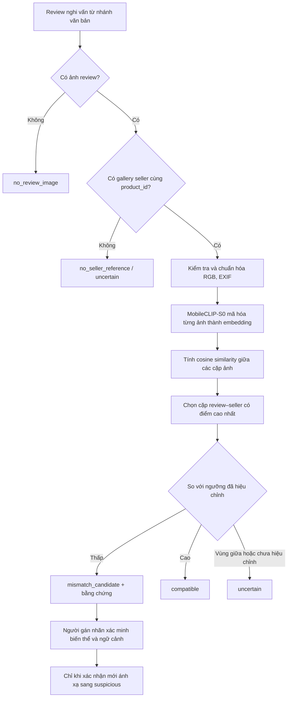

# Mô-đun xử lý và đối chiếu ảnh ReviewGuard VN

## 1. Mục đích

`src/img-process/` cung cấp nhánh thị giác cho ReviewGuard VN. Nhánh này nhận ảnh người mua đính kèm review và gallery ảnh do người bán công khai cho **cùng sản phẩm**, sau đó truy hồi cặp ảnh có biểu diễn thị giác gần nhau nhất. Mục tiêu là tạo bằng chứng hỗ trợ phát hiện review có ảnh không phù hợp với sản phẩm được đánh giá; mô-đun không tự xác minh danh tính người dùng, động cơ gian lận hoặc tính xác thực của toàn bộ review.

Theo luồng cascade đã đề xuất, việc so ảnh có thể được gọi sau khi nhánh văn bản đưa review vào diện nghi vấn. Tuy nhiên, để đánh giá khoa học tác dụng riêng của ảnh và tránh bỏ sót review chỉ có bất thường thị giác, cần chạy nhánh ảnh độc lập trên tập đánh giá có ảnh, rồi so sánh với cấu hình cascade.

## 2. Mô hình được lựa chọn

Mô-đun dùng **MobileCLIP-S0** làm encoder ảnh nhẹ. MobileCLIP được thiết kế theo hướng giảm độ trễ và kích thước cho tác vụ đa phương thức; công bố gốc báo cáo cân bằng độ chính xác–tốc độ cho truy hồi và phân loại zero-shot. Vì ReviewGuard VN cần biểu diễn ảnh thành vector để tìm ảnh tham chiếu gần nhất, image tower của MobileCLIP phù hợp hơn bộ phát hiện vật thể tổng quát vốn thường trả về nhãn lớp/vùng đối tượng nhưng không trực tiếp đánh giá mức tương tự giữa hai ảnh sản phẩm. [Bài báo MobileCLIP](https://arxiv.org/abs/2311.17049), [mã nguồn và model chính thức](https://github.com/apple-aiml-research/ml-mobileclip).

MobileCLIP-S0 được chọn làm **baseline nhẹ**, không phải lựa chọn đã được chứng minh tối ưu cho hàng hóa Việt Nam. Nó có thể nhận ra ngữ nghĩa/đặc trưng thị giác rộng, nhưng điểm gần embedding không đảm bảo nhận diện đúng SKU, màu, dung lượng, phiên bản hoặc biến thể. Vì thế, đầu ra luôn cần được hiệu chỉnh bằng tập cặp ảnh review–seller được gán nhãn; các trường hợp mơ hồ phải giữ `uncertain`.

## 3. Quy trình xử lý



Các ảnh người bán phải được nối bằng khóa ổn định `product_id` và nếu có thể là `variant_id`. Không được so ảnh review với gallery bất kỳ hoặc ảnh sản phẩm chỉ “trông giống”. Nhiều ảnh được hỗ trợ ở cả hai phía: mô-đun lấy điểm lớn nhất trong ma trận tương đồng để tìm ảnh tham chiếu gần nhất. Điểm này phục vụ retrieval; nó không phải xác suất review thật/giả.

## 4. Các tệp mã nguồn

| Tệp | Vai trò và liên hệ trong pipeline |
|---|---|
| `__init__.py` | Công bố API matcher khi thư mục được dùng như package. |
| `image_io.py` | Kiểm tra đường dẫn/đuôi tệp, giải mã ảnh, áp dụng hướng EXIF và chuyển sang RGB. Tách bước đọc ảnh giúp encoder chỉ nhận đầu vào hợp lệ; không tải URL từ Internet nên provenance và quyền thu thập nằm ở tầng dữ liệu. |
| `encoder.py` | Nạp MobileCLIP-S0 và checkpoint cục bộ; biến mỗi ảnh thành vector embedding chuẩn hóa L2. Nạp package theo nhu cầu để các phần text/schema vẫn hoạt động nếu chưa cài vision dependencies. |
| `matcher.py` | So sánh embedding ảnh review với gallery cùng sản phẩm bằng cosine similarity; chọn cặp tốt nhất; trả trạng thái, điểm, đường dẫn bằng chứng, product/variant và model. Ngưỡng phải được hiệu chỉnh trên validation. |
| `pipeline.py` | Điều phối cascade text-first: chỉ gọi matcher sau khi nhánh văn bản đánh dấu review nghi vấn; các review còn lại trả `not_checked`. |
| `README.md` | Mô tả giả định dữ liệu, cách cài, cách gọi, cấu trúc kết quả, giới hạn diễn giải và kế hoạch đánh giá. |

### Mối liên hệ với phần còn lại của repo

- `models/taxonomy.py` là nguồn chuẩn của nhãn review. Khi nhóm chính thức thông qua subtype `media_product_mismatch`, `matcher.py` có thể đề xuất subtype này qua `suggested_subtype`; hiện trạng `mismatch_candidate` **không tự động** trở thành nhãn `suspicious`.
- `src/data/schema.py` cần được mở rộng ở giai đoạn tích hợp để lưu manifest ảnh, `image_role`, `review_id`, `product_id`, `variant_id`, URI/hash, trạng thái đối chiếu và evidence. Thư mục hiện tại tập trung xử lý; chưa thay đổi schema dữ liệu hiện hữu.
- `src/data/clean_dataset.py` hoặc một bước tạo manifest chuyên biệt cần xác thực khóa nối và quyền/nguồn ảnh trước khi gọi matcher.
- Nhánh văn bản/pattern cung cấp trạng thái review nghi vấn và metadata; tầng ứng dụng gọi `assess_suspicious_review_images` để áp dụng gate text-first, sau đó hiển thị cặp ảnh bằng chứng và trạng thái cần phân xử.
- Kết quả của mô-đun ảnh cần được đánh giá riêng, sau đó mới đánh giá kết hợp text-only, image-only, text+image và cascade.

## 5. Cài đặt

Các phụ thuộc cơ bản là `Pillow`, `numpy`, `torch` và package MobileCLIP chính thức. `torch` đã có trong `requirements.txt` gốc; các phụ thuộc ảnh còn lại cần được bổ sung khi tích hợp nhánh này. Nên chọn bản PyTorch phù hợp hệ điều hành/phần cứng theo trang cài đặt chính thức của PyTorch.

```powershell
python -m pip install pillow numpy
python -m pip install torch torchvision
git clone https://github.com/apple-aiml-research/ml-mobileclip.git
cd ml-mobileclip
python -m pip install -e .
```

Tải checkpoint `mobileclip_s0.pt` từ kho chính thức theo hướng dẫn của Apple và lưu ngoài Git, ví dụ `models/vision/mobileclip_s0.pt`. Kiểm tra điều khoản cấp phép của mã, weights, dữ liệu và nền tảng ảnh trước khi phân phối hoặc dùng ảnh thu thập được. Không commit checkpoint lớn hoặc ảnh cá nhân vào repo công khai.

Tên thư mục `img-process` có dấu gạch nối nên không thể viết trực tiếp trong câu lệnh `import` Python. Các module hỗ trợ import sibling khi thư mục được thêm vào `sys.path`. Khi dự án bước sang giai đoạn tích hợp, có thể đổi tên thành `src/img_process/` để dùng cú pháp package thông thường; cấu trúc hiện tại vẫn giữ đúng yêu cầu thư mục.

## 6. Ví dụ sử dụng

Sau khi cài phụ thuộc/checkpoint, có thể gọi các module từ thư mục hiện tại như sau:

```python
import sys
from pathlib import Path

sys.path.insert(0, str(Path("src/img-process").resolve()))
from encoder import MobileClipImageEncoder
from pipeline import assess_suspicious_review_images

encoder = MobileClipImageEncoder(
    checkpoint_path="models/vision/mobileclip_s0.pt",
    device="cpu",  # hoặc "cuda" nếu môi trường hỗ trợ
)

result = assess_suspicious_review_images(
    text_is_suspicious=True,
    review_images=["data/images/review/R001_1.jpg"],
    seller_images=[
        "data/images/listing/P001_main.jpg",
        "data/images/listing/P001_side.jpg",
    ],
    encoder=encoder,
    product_id="P001",
    variant_id="P001-BLACK-128GB",
    # Chỉ truyền sau khi đã hiệu chỉnh trên tập validation gán nhãn.
    mismatch_threshold=0.35,
    compatible_threshold=0.55,
)
print(result.to_dict())
```

Hai ngưỡng trong ví dụ chỉ minh họa cú pháp, **không phải ngưỡng khuyến nghị hay kết quả đã kiểm chứng**. Không dùng chúng để gán nhãn nghiên cứu. Khi chưa truyền ngưỡng, hàm vẫn trả điểm và cặp ảnh gần nhất nhưng trạng thái là `uncertain`.

## 7. Diễn giải kết quả

| Trạng thái | Diễn giải |
|---|---|
| `no_review_image` | Review không có ảnh người mua; không kết luận về tính đáng tin cậy. |
| `no_seller_reference` | Không có ảnh tham chiếu seller; nhánh ảnh không đủ dữ liệu. |
| `compatible` | Điểm đạt ngưỡng tương thích đã hiệu chỉnh; đây không phải chứng minh review trung thực. |
| `mismatch_candidate` | Điểm thấp hơn ngưỡng mismatch; là ứng viên cần kiểm tra, không phải kết luận gian lận tự động. |
| `uncertain` | Chưa hiệu chỉnh ngưỡng, thiếu product ID, hoặc điểm nằm trong vùng bất định. |
| `processing_error` | Ảnh không đọc/giải mã được; lưu lỗi để xử lý lại, không gán nhãn nội dung. |

Nếu người gán nhãn xác nhận ảnh rõ ràng thuộc sản phẩm khác sau khi xét biến thể, phụ kiện, bao bì và bối cảnh, hệ thống có thể ánh xạ review sang `suspicious` với subtype đề xuất `media_product_mismatch`. Cần cập nhật `SuspiciousSubtype` trong `models/taxonomy.py`, guideline trong `docs/taxonomy-v1.md`, schema lưu evidence và annotation trước khi dùng subtype như nhãn chính thức. Ảnh không tương đồng có thể do góc chụp, ánh sáng, crop, sản phẩm đã sử dụng, ảnh bao bì/phụ kiện hoặc biến thể hợp lệ.

## 8. Đánh giá và tiêu chí hoàn thiện

1. Tạo tập cặp ảnh có nhãn `compatible`, `incompatible`, `uncertain` và `not_comparable`; gán nhãn độc lập và phân xử bất đồng.
2. Chia train/validation/test theo `product_id` (và `variant_id` nếu phù hợp), tránh để ảnh cùng sản phẩm rơi vào nhiều tập.
3. Chọn ngưỡng trên validation; khóa ngưỡng trước khi báo cáo test. Báo cáo precision, recall, macro-F1, PR-AUC, confusion matrix, tỷ lệ không đủ dữ liệu và phân tích theo ngành hàng/biến thể.
4. So sánh MobileCLIP-S0 retrieval với baseline ảnh đơn giản và các cấu hình text-only/image-only/text+image. Đo độ trễ CPU/GPU, bộ nhớ và tỷ lệ lỗi ảnh.
5. Hoàn thiện nhánh khi pipeline có thể tái lập, lưu model/version và cặp ảnh bằng chứng, xử lý thiếu/hỏng ảnh an toàn, đạt chất lượng đã xác định trước trên tập test độc lập, và mọi tuyên bố về phát hiện fake review đều được giới hạn theo nhãn và dữ liệu thực tế.

Do workbook hiện có chưa chứa ảnh review, ảnh seller gallery, `product_id` hoặc `variant_id`, mô-đun này chưa thể chạy trực tiếp trên `data/dataset.xlsx`. Cần thu thập/được phép sử dụng ảnh và xây manifest liên kết trước khi đánh giá.

## Tài liệu tham khảo

- Vasu, P. K. A., et al. (2024). *MobileCLIP: Fast Image-Text Models through Multi-Modal Reinforced Training*. CVPR. https://arxiv.org/abs/2311.17049
- Apple Machine Learning Research. *ml-mobileclip: implementation, pretrained models, and licenses*. https://github.com/apple-aiml-research/ml-mobileclip
